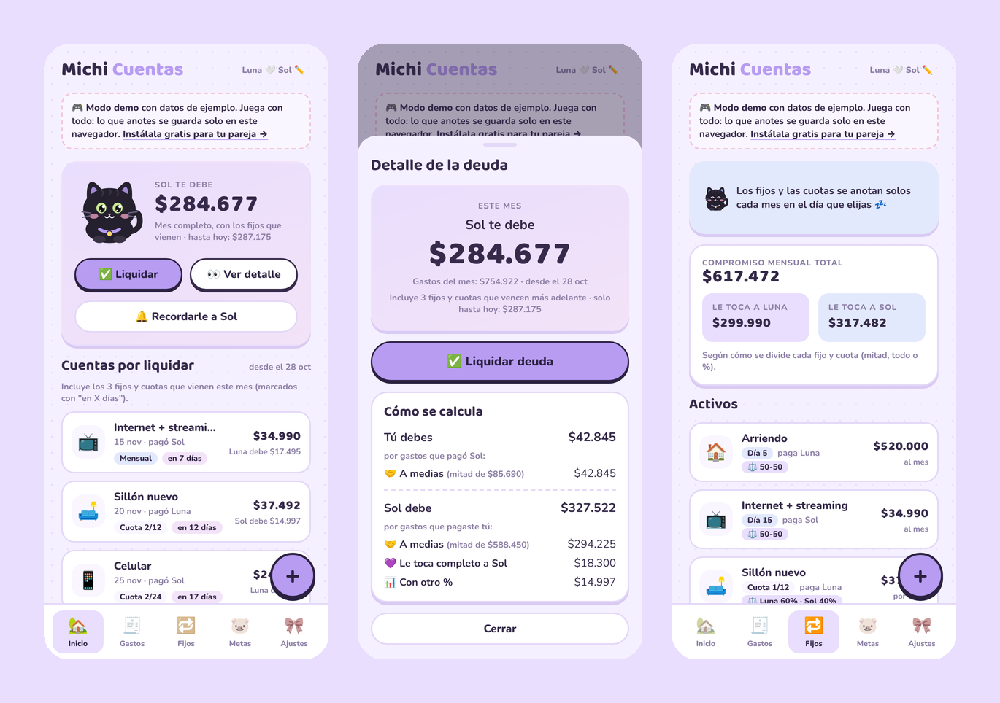
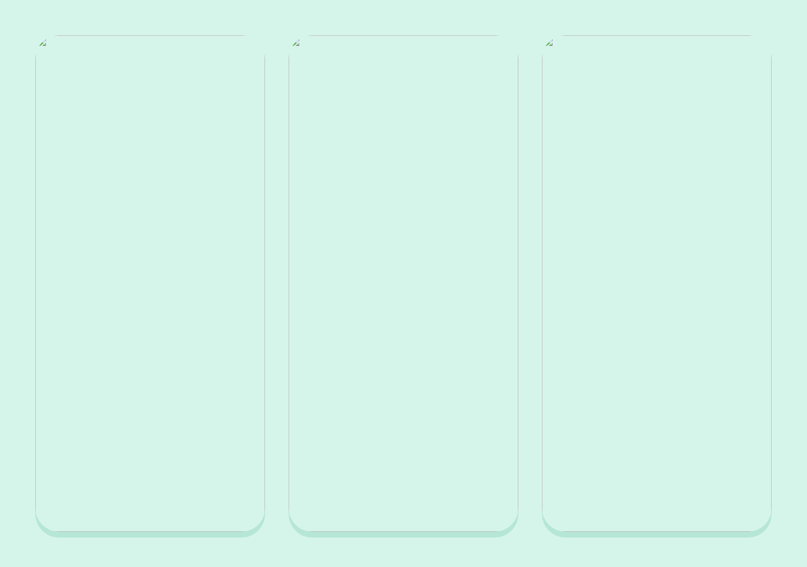
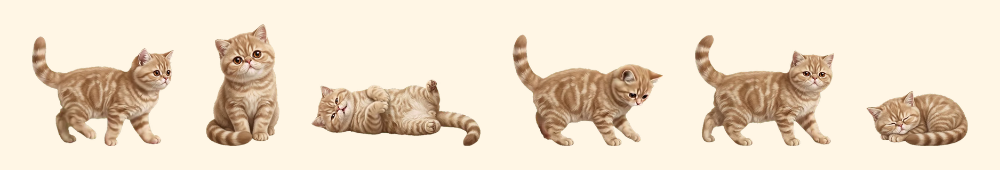

<div align="center">

# 🐾 Michi Apps

**Apps gratuitas y adorables, con gatitos, para el día a día.**
Hechas con cariño por [Rocío Maure](https://github.com/rociomaure). Descárgalas, úsalas y compártelas.

[🌐 Ver la portada](https://rociomaure.github.io/michi-apps/)

</div>

| | App | Para qué sirve | Dónde funciona | Probar / descargar |
|:-:|---|---|---|---|
| 🐈‍⬛ | **[Michi Cuentas](michi-cuentas/)** | Los gastos **en pareja**: fijos, cuotas, quién le debe a quién y recordatorios | Celular (Android y iPhone) | [🎮 Demo](https://rociomaure.github.io/michi-apps/michi-cuentas/) · [Instalar](michi-cuentas/#instálala-gratis) |
| 🐱 | **[Michi Cuentas Team](michi-cuentas-team/)** | Los gastos **del grupo**: viajes, roomies, asados. Divide entre todas o algunas y simplifica las deudas | Celular (Android y iPhone) | [📱 Usarla ya](https://rociomaure.github.io/michi-apps/michi-cuentas-team/) · [🎮 Demo](https://rociomaure.github.io/michi-apps/michi-cuentas-team/?demo=1) |
| 🐈 | **[Michi Pet](michi-pet/)** | Un gatito que vive en tu escritorio: camina, juega con su ovillo y, si le haces doble clic, se tira panza arriba a ronronear | Windows | [🎮 Demo](https://rociomaure.github.io/michi-apps/michi-pet/demo/) · [⬇️ Descargar](https://github.com/rociomaure/michi-apps/releases/latest) |
| ✂️ | **[Michi Print](michi-print/)** | Recortar la pantalla con un atajo y un cursor de patita | Windows | [⬇️ Descargar](https://github.com/rociomaure/michi-apps/releases/latest) |
| 🖌️ | **[Michi Paint](michi-paint/)** | Rayar y anotar encima de cualquier programa (PPT, videos, clases) | Windows | [⬇️ Descargar](https://github.com/rociomaure/michi-apps/releases/latest) |

<div align="center">

<br><br>

<br><br>

</div>

## ¿Cómo está organizado?

```
michi-apps/
├── michi-cuentas/        Cuentas en pareja, app para el celular (con demo)
├── michi-cuentas-team/   Cuentas del grupo, app para el celular, lista para usar y cifrada
├── michi-pet/            Mascota de escritorio para Windows (con demo web)
├── michi-print/          Recortes de pantalla para Windows
├── michi-paint/          Dibujar sobre la pantalla para Windows
└── index.html             La portada de Michi Apps
```

Cada carpeta tiene su propio README con capturas, cómo instalarla y cómo está hecha. Los instaladores de Windows están en **[Releases](https://github.com/rociomaure/michi-apps/releases/latest)**.

## ¿Cómo las uso?

- 📱 **Quiero usarlas y listo:** cada app tiene un link para abrirla en el celular o un instalador para Windows. Sin saber nada de tecnología.
- 🛠️ **Quiero el código:** todo es abierto. Cada carpeta explica cómo publicar tu propia copia y modificarla.

## 🔒 Tu privacidad

- **Yo no tengo acceso a tus datos.** Michi Cuentas Team cifra todo en tu celular antes de guardarlo: en la base de datos solo queda texto ilegible.
- Los demos guardan todo solo en tu navegador.
- Michi Pet, Michi Print y Michi Paint funcionan en tu computador y no envían nada a internet.
- El código está a la vista: puedes revisar exactamente qué hace cada app.

## ¿Por qué Michi Apps?

- 💸 **Gratis de verdad**: sin anuncios, sin suscripciones, sin límites
- 🔒 **Tus datos son tuyos**: cada app guarda la información en tu propia cuenta o en tu computador
- 🐱 **Hechas para que den ganas de usarlas**: colores suaves, gatitos y detalles cute

## Contacto

¿Ideas, errores o quieres contarme cómo usas las Michi Apps? 💌

- ✉️ **rocio.maure@gmail.com**
- 🐙 [github.com/rociomaure](https://github.com/rociomaure)
- 🐞 O abre un [issue](https://github.com/rociomaure/michi-apps/issues) en este repositorio

## Licencia

[MIT](LICENSE) © 2026 Rocío Maure. Puedes usar, modificar y compartir estas apps libremente; solo mantén el crédito. 🐾

Si te gustan, ⭐ dale una estrella al repo, ¡me ayuda mucho!
