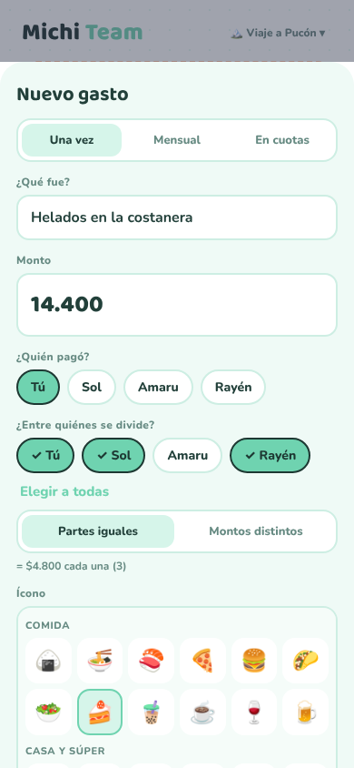
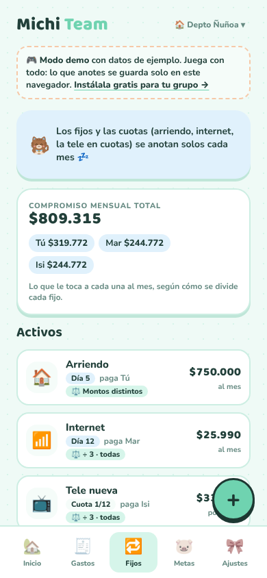
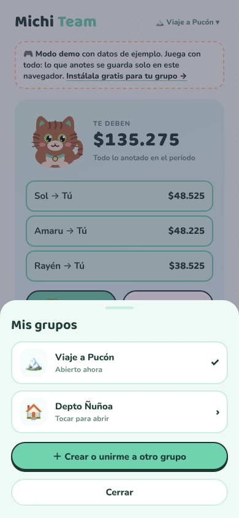

# Michi Cuentas Team

**Las cuentas del grupo, claritas: viajes, roomies, asados o el regalo de cumpleaños.** 🐱💚

Una app para el celular (Android y iPhone), gratis, sin anuncios y con cifrado de extremo a extremo.

[📱 Usarla ahora](https://rociomaure.github.io/michi-apps/michi-cuentas-team/) · [🎮 Ver el demo](https://rociomaure.github.io/michi-apps/michi-cuentas-team/?demo=1) · [🐈‍⬛ ¿Es para tu pareja? Michi Cuentas](../michi-cuentas/) · [💌 Volver a Michi Apps](../README.md)

## ¿Qué es?

La app para llevar los gastos compartidos de un grupo, de 2 a 12 personas. Anotas quién pagó qué y Michi te dice quién le tiene que transferir a quién, con la menor cantidad de transferencias posible. Es como Splitwise, pero sin límites diarios, sin anuncios y con un gatito café. 🐾

> ¿Son dos y viven juntas? Mira **[Michi Cuentas](../michi-cuentas/)**, la versión para parejas.

## Lo que hace

- ✂️ **Divide entre todas o solo algunas**: "el kayak lo pagamos Sol y yo", "Amaru no fue a las termas"
- ⚖️ **Partes iguales o montos distintos**: perfecto para la pieza grande que paga más arriendo
- 🔄 **Simplifica las deudas**: en vez de 6 transferencias cruzadas, te dice "Sol le paga $48.525 a Luna" y listo
- ✅ **Liquidar**: marca cada transferencia cuando se hace, o cierra todo de una vez; el período queda en el historial
- 🔁 **Fijos y cuotas que se anotan solos**: arriendo, internet, la tele en 12 cuotas
- 👥 **Integrantes sin app**: anota los gastos de alguien que no la instaló
- 🧳 **Varios grupos a la vez**: "Viaje a Pucón" y "Depto Ñuñoa" en el mismo celular
- 🔔 **Recordatorios** al celular de todo el grupo o de una persona
- 📸 Foto de la boleta, notas, reacciones 😻, metas de ahorro y descarga para Excel

<table>
<tr>
<td></td>
<td></td>
<td></td>
</tr>
</table>

## 🔒 Tu privacidad

- **Nadie más puede ver tus cuentas, ni siquiera quien hizo la app.** Todo se cifra en tu celular (AES-256) antes de guardarse, y la llave de cada grupo viaja solo dentro del link de invitación.
- La base de datos solo guarda texto ilegible y lo mínimo para funcionar: qué celular pertenece a qué grupo y la fecha de cada registro.
- **Sin registro, sin correo y sin contraseñas.**
- El código es abierto: puedes revisar exactamente qué hace.

> 🔑 **Importante:** el link de invitación es la llave del grupo. Guárdalo (por ejemplo, en tu chat de WhatsApp) por si cambias de celular, y compártelo solo con el grupo.

---

## 📱 Camino 1 · Quiero usarla y listo

No necesitas saber nada de tecnología.

1. **Abre la app en tu celular:** [rociomaure.github.io/michi-apps/michi-cuentas-team](https://rociomaure.github.io/michi-apps/michi-cuentas-team/)
2. **Crea tu grupo:** ponle nombre (ej: "Viaje a Pucón"), elige un ícono, escribe tu nombre y el de las demás
3. **Invita al grupo:** en **Ajustes → Invitar al grupo**, toca **WhatsApp** y mándalo al chat del grupo
4. Cada persona abre el link, **toca su nombre** y listo 🎉

### Instálala como app (queda con su ícono de gatito)

- **Android (Chrome):** abre la app → menú **⋮** → **Instalar app** (o "Agregar a pantalla principal")
- **iPhone (Safari):** abre la app → botón **Compartir** (cuadrito con flecha) → **Agregar a inicio**

> 💡 **En iPhone:** la app instalada y Safari no comparten lo guardado. Si abriste el link de invitación en Safari y después instalaste la app, ábrela desde el ícono, toca **"¿Te invitaron?"** y pega el link.

---

## 🛠️ Camino 2 · Quiero el código (para personas técnicas)

Tu propia copia, en tu propia cuenta, para modificarla como quieras. Todo con planes gratuitos.

1. **Supabase:** crea un proyecto en [supabase.com](https://supabase.com)
   - **SQL Editor → New query** → pega [`supabase/schema.sql`](supabase/schema.sql) → **Run**
   - **Authentication → Sign In / Providers** → activa **Allow anonymous sign-ins**
   - (Opcional, para recordatorios) **Edge Functions → Deploy a new function → Via editor** → nombre `recordar-team` → pega [`supabase/functions/recordar-team/index.ts`](supabase/functions/recordar-team/index.ts) → **Deploy** → en sus **Settings** desactiva **Verify JWT with legacy secret**
2. **Conecta la app:** en [`config.js`](config.js) pega tu *Project URL* y tu *publishable key*
3. **Publícala** en [Vercel](https://vercel.com), GitHub Pages o cualquier hosting de archivos estáticos (no tiene pasos de compilación)

### Cómo está hecha

- HTML, CSS y JavaScript sin frameworks, instalable como PWA
- [Supabase](https://supabase.com) para la base de datos, la sesión anónima, las fotos y el tiempo real
- Cifrado con Web Crypto (AES-256-GCM) en [`data.js`](data.js); el modo demo vive en [`demo.js`](demo.js)
- Notificaciones Web Push con una Edge Function que no guarda nada

## Contacto

💌 rocio.maure@gmail.com · [Más Michi Apps](https://github.com/rociomaure/michi-apps)

## Licencia

[MIT](../LICENSE) © 2026 Rocío Maure. Úsala, cámbiala y compártela; solo mantén el crédito. 🐾
