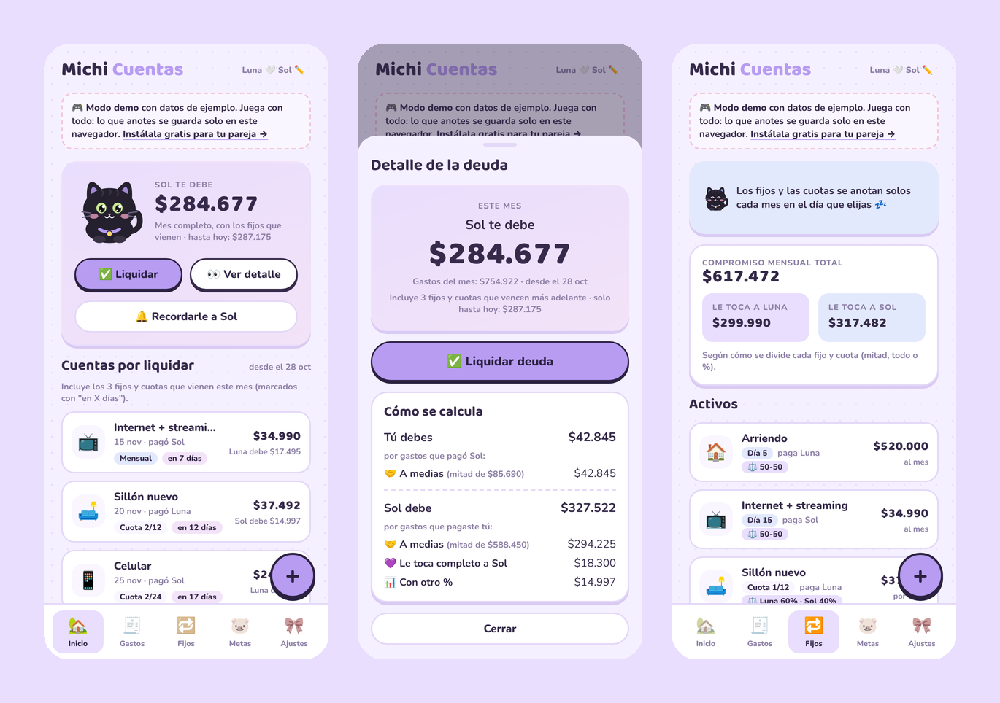
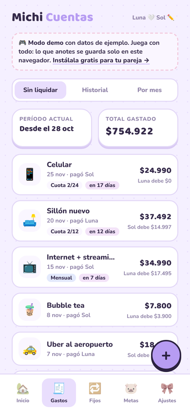
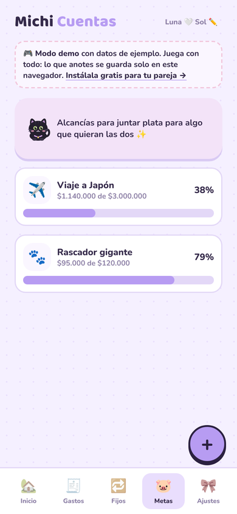
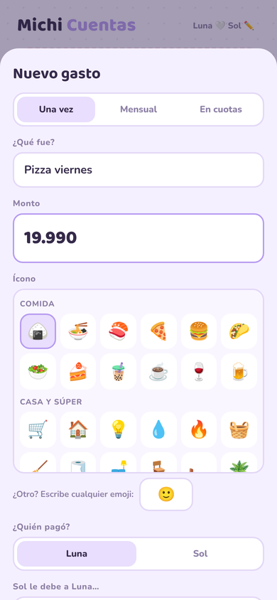

# Michi Cuentas

**Las cuentas de la pareja, con un gatito que te dice quién le debe a quién.** 🐈‍⬛💜

Una app para el celular (Android y iPhone), gratis, sin anuncios y con cifrado de extremo a extremo.

[📱 Usarla ahora](https://rociomaure.github.io/michi-apps/michi-cuentas/) · [🎮 Ver el demo](https://rociomaure.github.io/michi-apps/michi-cuentas/?demo=1) · [🐱 ¿Es para un grupo? Michi Cuentas Team](../michi-cuentas-team/) · [💌 Volver a Michi Apps](../README.md)

## ¿Qué es?

Una app para llevar los gastos compartidos en pareja (o con tu roomie), hecha para el celular. Se abre desde un link, se instala con su ícono de gatito y se sincroniza en vivo entre los dos teléfonos. Es como Splitwise, pero sin límites diarios, sin anuncios y mucho más cute.

> ¿Son más de dos (un viaje, roomies, un asado)? Mira **[Michi Cuentas Team](../michi-cuentas-team/)**, la versión para grupos.

## Lo que hace

- 🔁 **Gastos fijos y en cuotas que se anotan solos**: el arriendo cada mes, el sillón en 12 cuotas, el celular en 24
- ⚖️ **Cada gasto se divide como quieras**: todo, la mitad o un %
- 🐱 **Te dice clarito quién debe**: "Sol te debe $284.677" en un celular y "Le debes a Luna" en el otro
- ✅ **Liquidar deuda**: cuando transfieren, un toque cierra el período, lo guarda en el historial y deja todo en blanco
- 🔔 **Recordatorios**: "¡Hay que liquidar las cuentas! 💸" le llega como notificación al celular de tu pareja
- 📸 **Foto de la boleta**, notas y reacciones 😻 en cada gasto
- 🎨 **90 íconos** (comida, casa y muebles, suscripciones, mascotas…) o cualquier emoji
- 🎯 **Presupuesto mensual** con aviso al 80 %
- 🐷 **Metas de ahorro** compartidas
- 🔎 Buscador, gráfico de 6 meses y descarga para Excel
- 📴 Funciona sin internet para mirar

<table>
<tr>
<td></td>
<td></td>
<td></td>
</tr>
</table>

## 🔒 Tu privacidad

- **Nadie más puede ver sus cuentas, ni siquiera quien hizo la app.** Todo se cifra en tu celular (AES-256) antes de guardarse, y la llave de su libreta viaja solo dentro del link de invitación.
- La base de datos solo guarda texto ilegible y lo mínimo para funcionar: qué celular pertenece a qué libreta y la fecha de cada registro.
- **Sin registro, sin correo y sin contraseñas.**
- El código es abierto: puedes revisar exactamente qué hace.

> 🔑 **Importante:** el link de invitación es la llave de su libreta. Guárdenlo (por ejemplo, en su chat de WhatsApp) por si cambian de celular, y no lo compartan con nadie más.

---

## 📱 Camino 1 · Quiero usarla y listo

No necesitas saber nada de tecnología.

1. **Abre la app en tu celular:** [rociomaure.github.io/michi-apps/michi-cuentas](https://rociomaure.github.io/michi-apps/michi-cuentas/)
2. **Crea su libreta:** escribe tu nombre y el de tu pareja
3. **Invita a tu pareja:** en **Ajustes → Invitar a tu pareja**, toca **WhatsApp** y mándale el link
4. Tu pareja abre el link, **toca su nombre** y listo 💜

¿Quieres probar antes? Abre el **[demo](https://rociomaure.github.io/michi-apps/michi-cuentas/?demo=1)**: viene con datos de ejemplo de Luna y Sol, y lo que hagas se guarda solo en tu navegador.

### Instálala como app (queda con su ícono de gatito)

- **Android (Chrome):** abre la app → menú **⋮** → **Instalar app** (o "Agregar a pantalla principal")
- **iPhone (Safari):** abre la app → botón **Compartir** (cuadrito con flecha) → **Agregar a inicio**
- Cada una activa las notificaciones en **Ajustes → Notificaciones** 🔔

> 💡 **En iPhone:** la app instalada y Safari no comparten lo guardado. Si abriste el link de invitación en Safari y después instalaste la app, ábrela desde el ícono, toca **"¿Te invitaron?"** y pega el link.

---

## 🛠️ Camino 2 · Quiero el código (para personas técnicas)

Tu propia copia, en tu propia cuenta, para modificarla como quieras. Todo con planes gratuitos.

1. **Supabase:** crea un proyecto en [supabase.com](https://supabase.com)
   - **SQL Editor → New query** → pega [`supabase/schema.sql`](supabase/schema.sql) → **Run**
   - **Authentication → Sign In / Providers** → activa **Allow anonymous sign-ins**
   - (Opcional, para recordatorios) **Edge Functions → Deploy a new function → Via editor** → nombre `recordar-pareja` → pega [`supabase/functions/recordar-pareja/index.ts`](supabase/functions/recordar-pareja/index.ts) → **Deploy** → en sus **Settings** desactiva **Verify JWT with legacy secret**
2. **Conecta la app:** en [`config.js`](config.js) pega tu *Project URL* y tu *publishable key*
3. **Publícala** en [Vercel](https://vercel.com), GitHub Pages o cualquier hosting de archivos estáticos (no tiene pasos de compilación)

> Michi Cuentas y Michi Cuentas Team usan tablas distintas (`pareja_…` y `team_…`), así que pueden vivir en el mismo proyecto de Supabase.

### Cómo está hecha

- HTML, CSS y JavaScript sin frameworks, instalable como PWA
- [Supabase](https://supabase.com) para la base de datos, la sesión anónima, las fotos y el tiempo real
- Cifrado con Web Crypto (AES-256-GCM) en [`data.js`](data.js); el modo demo vive en [`demo.js`](demo.js)
- Notificaciones Web Push con una Edge Function que no guarda nada

## Contacto

💌 rocio.maure@gmail.com · [Más Michi Apps](https://github.com/rociomaure/michi-apps)

## Licencia

[MIT](../LICENSE) © 2026 Rocío Maure. Úsala, cámbiala y compártela; solo mantén el crédito. 🐾
