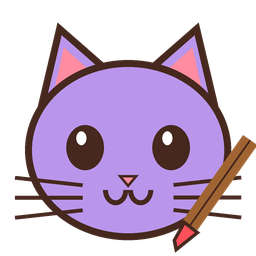

<div align="center">



# Michi Paint

**Raya, subraya y anota encima de cualquier programa.** Ideal para presentaciones, clases y videollamadas. 🖌️🐾

[⬇️ Descargar para Windows](https://github.com/rociomaure/michi-apps/releases/latest) · [✂️ Ver Michi Print](../michi-print/) · [💌 Volver a Michi Apps](../README.md)

</div>

## Lo que hace

- 🖊️ **Dibuja sobre la pantalla** encima de PowerPoint, videos, el navegador o lo que tengas abierto
- 🧰 Barra flotante con **lápiz, destacador, flecha, rectángulo y texto**
- 🎨 **6 colores** y **3 grosores**
- ↩️ Deshacer, borrar todo, pausar para usar el programa de abajo y seguir dibujando
- 🐈 El cursor es una **colita de gatito** color arequipe con un lacito rosado
- 🐾 Vive como una gatita lila junto al reloj de Windows

## Atajos

| Atajo | Qué hace |
|---|---|
| `Ctrl` + `Shift` + `↑` | Empezar a dibujar / pausar / seguir |
| `Ctrl` + `Shift` + `↓` | Borrar el dibujo y cerrar |
| `Esc` | Cerrar el dibujo |
| `Ctrl` + `Z` | Deshacer |

Puedes cambiar o desactivar los atajos con clic derecho en la gatita → **Atajos de teclado**.

## Instalarlo

1. Descarga **Michi-Print-y-Paint-v2.0.zip** desde [Releases](https://github.com/rociomaure/michi-apps/releases/latest) (trae Michi Paint y [Michi Print](../michi-print/))
2. Descomprime la carpeta **Michi** en un lugar fijo, por ejemplo `Documentos\Michi`
3. Doble clic en **MichiPaint.exe**

> 💡 Como es una app nueva y sin firma comercial, Windows puede mostrar "Windows protegió su PC". Toca **Más información → Ejecutar de todas formas**.

## Cómo está hecho

C# con .NET 8 y Windows Forms. El código está en [`src/`](src/). Para compilarlo en Windows:

```
dotnet publish src/MichiPaint.csproj -c Release -r win-x64 --self-contained
```

## Contacto

💌 rocio.maure@gmail.com · [Más Michi Apps](https://github.com/rociomaure/michi-apps)

## Licencia

[MIT](../LICENSE) © 2026 Rocío Maure. 🐾
