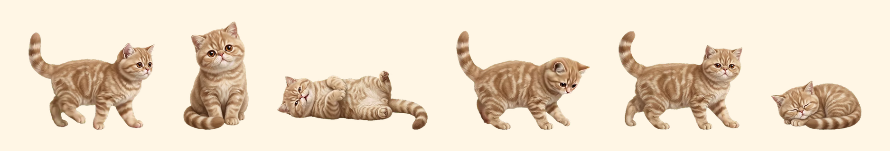

# Michi Pet

**Un gatito que vive en tu escritorio.** Camina, ronronea, duerme siesta y juega con su ovillo encima de todas tus ventanas. 🐾

[🎮 Conócelo en el navegador](https://rociomaure.github.io/michi-apps/michi-pet/demo/) · [⬇️ Descargar para Windows](https://github.com/rociomaure/michi-apps/releases/latest) · [💌 Volver a Michi Apps](../README.md)

## Lo que hace

- 🚶 **Pasea** por la parte de abajo de tu pantalla, encima de todo
- 😻 **Ronronea panza arriba** si lo frotas con el mouse un rato
- 🤲 **Lo puedes tomar en brazos**: arrástralo y "corre" en el aire hacia donde lo muevas; al soltarlo cae de patitas
- 🐾 **Amasa** y mueve las patitas cuando está contento
- 🧶 **Juega con su ovillo**: lo persigue, lo golpea y se desenrolla la lana (también lo puedes lanzar tú)
- 😴 **Duerme siestas en una esquina** para no tapar lo que estás leyendo, y se despierta con un clic
- 🔊 Maúlla y ronronea (se puede silenciar)
- 🪶 **No estorba**: los clics pasan a través de él; solo responde cuando el mouse está encima del gatito

## Instalarlo

1. Descarga **Instalar-Michi-Pet.exe** desde [Releases](https://github.com/rociomaure/michi-apps/releases/latest)
2. Ábrelo y sigue el asistente (no pide permisos de administrador)
3. Busca su carita junto al reloj de Windows para **llamarlo, darle el ovillo, mandarlo a dormir, esconderlo o hacer que parta con Windows**

> 💡 Como es una app nueva y sin firma comercial, Windows puede mostrar "Windows protegió su PC". Toca **Más información → Ejecutar de todas formas**.

Para desinstalarlo: Configuración de Windows → Aplicaciones → **Michi Pet** → Desinstalar.

## Novedades de la versión 1.1

- 🔧 Ya no se queda "pegado" después de suspender el computador: lo puedes volver a tomar con el mouse
- 🔧 Se despierta al tiro con un clic o doble clic
- 😴 Cuando le da sueño, camina a la esquina más cercana para dormir sin molestar
- 🔒 "Iniciar con Windows" ahora es opcional (se activa desde el menú del ícono)

## Cómo está hecho

- [Electron](https://www.electronjs.org/): una ventana transparente, siempre encima y que deja pasar los clics
- Animaciones en video WebM con fondo transparente, generadas con IA y recortadas a mano
- El comportamiento (caminar, perseguir el ovillo, la física al soltarlo) está en [`src/pet.js`](src/pet.js), el mismo archivo que usa el [demo web](demo/)

Para armarlo tú: instala Node.js, crea un proyecto Electron con los archivos de [`src/`](src/) y ejecuta `npx electron .`. El instalador se arma con [NSIS](https://nsis.sourceforge.io/) usando [`src/installer.nsi`](src/installer.nsi).

## Contacto

💌 rocio.maure@gmail.com · [Más Michi Apps](https://github.com/rociomaure/michi-apps)

## Licencia

Código bajo [MIT](../LICENSE) © 2026 Rocío Maure. 🐾
